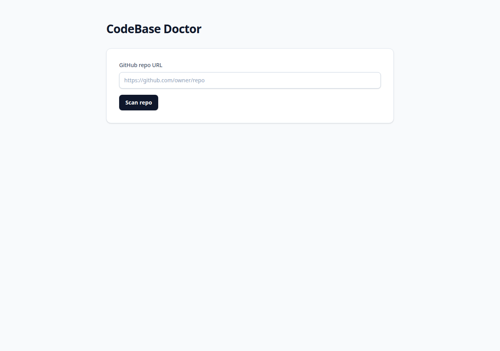
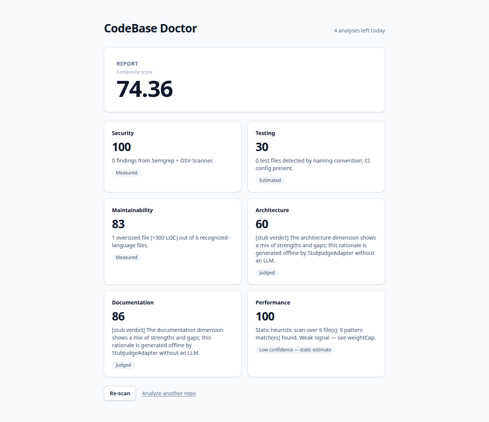
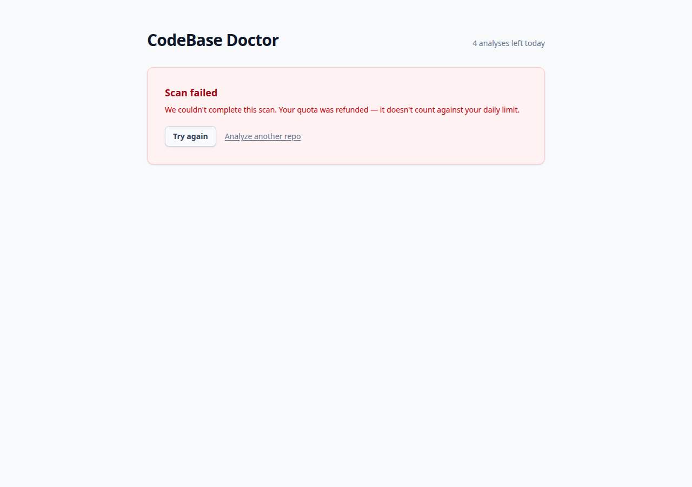
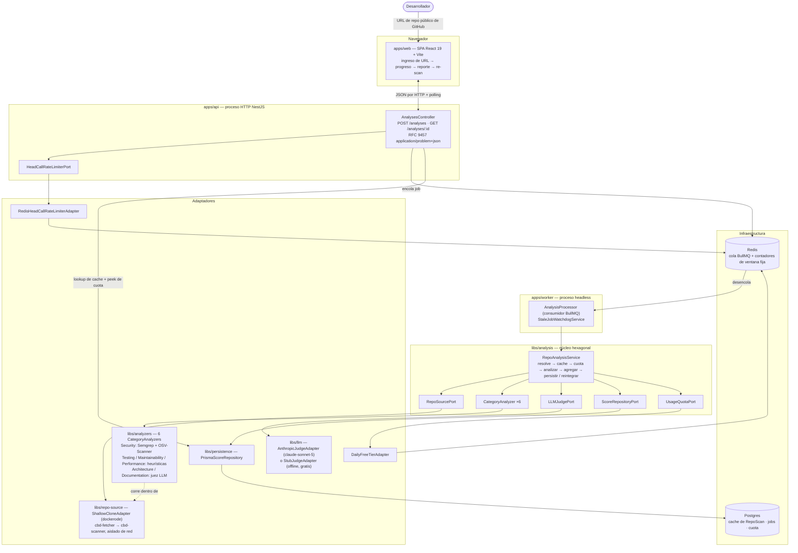

<p align="center">
  
</p>

<h1 align="center">CodeBase Doctor IA</h1>

<p align="center">
  <strong>Pasale la URL de un repositorio público de GitHub.<br>
  Te devuelve un puntaje de 0 a 100 en seis dimensiones de ingeniería — cada una con una explicación escrita y una etiqueta de confianza.</strong>
</p>

<p align="center">
  
  
  
  
  
  
  
  
  
  
  
</p>


---

## Qué hace

CodeBase Doctor IA hace un shallow-clone de un repo público de GitHub dentro de un sandbox descartable y aislado de red, y corre seis analizadores independientes sobre él:

| Dimensión | Cómo se puntúa | Etiqueta de confianza | Peso |
| --- | --- | --- | --- |
| **Architecture** | Juez LLM (`LLMJudgePort`) sobre la estructura y el layering del repo | `judged` | 1.0 |
| **Security** | **Semgrep** + **OSV-Scanner** reales, ejecutados offline dentro del contenedor `cbd-scanner` | `measured` | 1.0 |
| **Testing** | Heurísticas deterministas — ratio de archivos de test, convenciones de nombres, config de CI | `estimated` | 1.0 |
| **Maintainability** | Heurística determinista — proporción de archivos fuente sobredimensionados | `measured` | 1.0 |
| **Performance** | Escaneo estático de patrones heurísticos | `estimated` | **0.5** |
| **Documentation** | Pre-chequeo de presencia de README que alimenta a un juez LLM | `judged` | 1.0 |

El **puntaje compuesto** es la media ponderada de las categorías que efectivamente produjeron un puntaje, cada una ponderada por su cap. Performance está deliberadamente capado en `0.5` — la UI lo muestra como *"Low confidence — static estimate"* para que una señal débil nunca domine el número principal.

Un scan necesita que **al menos 4 de 6** categorías puntúen. En ese umbral o por encima, el resultado se persiste como `complete` (6/6) o `partial` (4–5/6) y se conserva la unidad de cuota diaria del usuario. Por debajo, el job se marca `failed` y **la unidad de cuota se reintegra**.

El sandbox **nunca ejecuta código provisto por el repositorio** — no corre ningún paso de `install`, `build` ni `test`. La ingesta tiene topes duros (~500 MB / 50k archivos, timeout de clone de 120 s, timeout de scan de 300 s) y es auditable por scan.

### Ejemplo

```bash
curl -s -XPOST localhost:3000/analyses \
  -H 'content-type: application/json' \
  -d '{"repoUrl":"https://github.com/tj/commander.js","forceRescan":false}'
# -> 202 { "jobId": "…", "status": "queued", "commitSha": "…", "pollAfterMs": 2000, "quota": { … } }

curl -s localhost:3000/analyses/<jobId>
# -> 202 mientras analiza (progreso por categoría) … luego 200 con el reporte completo de seis puntajes
```

---

## Capturas

La SPA tiene cuatro estados: ingreso de URL → progreso en vivo por categoría → reporte → re-scan.

| | |
| --- | --- |
|  | **Ingreso de URL** — pegás una URL pública de GitHub. |
|  | **Progreso en vivo por categoría** — el cliente hace polling a `GET /analyses/:id`; cada una de las seis categorías pasa por `pending → running → scored`. |
|  | **Reporte completo** — seis tarjetas, puntaje compuesto, pills de confianza `measured` / `estimated` / `judged`, cuota diaria restante, y "Re-scan" / "Analyze another repo". |
|  | **Reporte parcial** — una categoría no se pudo puntuar (≥ 4 de 6 igual lo lograron). La tarjeta muestra "Could not be scored" con un botón de Retry; el compuesto se calcula con las categorías que sí puntuaron. |
|  | **Scan fallido** — menos de 4 categorías puntuaron, o un timeout de clone/scan. El job queda `failed` y la unidad de cuota diaria se reintegra. |

---

## Arquitectura

Monorepo con pnpm workspaces, hexagonal (ports-and-adapters). Dos procesos NestJS comparten una librería de dominio; una SPA de React habla únicamente con el proceso HTTP.



`RepoAnalysisService` es el núcleo hexagonal: nunca toca git, Docker, un SDK de LLM ni SQL directamente — sus únicas aristas salientes son los ports de arriba.

### Ciclo de vida de un request

1. **`POST /analyses`** → `resolve(repoUrl)` — parsing puro y barato de la URL. Una URL malformada tira `InvalidRepoUrlError` → `400`.
2. **Chequeo de rate-limit** — `HeadCallRateLimiterPort.checkAndRecord(actorId)`, una compuerta de ventana fija sobre cuán seguido un actor puede disparar el paso costoso de lookup del repo. Por encima del límite → `429 /errors/rate-limited` (un tipo de error distinto del de cuota).
3. **`head(ref)`** — levanta el contenedor `cbd-fetcher`, corre `git ls-remote`, resuelve el commit SHA actual. Un repo privado o inexistente tira `RepoNotAccessibleError` (los dos casos son deliberadamente indistinguibles) → `422`.
4. **Chequeo de cache** — `findCached({ repoUrl, commitSha, engineVersion })`. Un hit devuelve el reporte cacheado de inmediato (`200`, `cached: true`) — **no consume cuota y no hace trabajo**. Se saltea por completo cuando `forceRescan: true`.
5. **Consumo de cuota** — en un cache miss, `UsageQuotaPort.consume(actorId, reservationId)` reserva una unidad diaria *antes* de que exista fila de job. Por encima del límite diario → `429 /errors/quota-exceeded` (con `Retry-After`).
6. **Encolado** — crea la fila `analysis_job`, empuja un job de BullMQ a Redis, adjunta el id del job de Bull, devuelve `202 { jobId }`.
7. **Worker** — `AnalysisProcessor` materializa el workspace (shallow clone en un volumen efímero aislado de red vía `cbd-fetcher`, luego escanea dentro de `cbd-scanner`), corre los **6 analizadores en paralelo**, y agrega.
8. **Persistir o reintegrar** — si puntuaron ≥ 4 de 6 categorías, persiste el `RepoScan` (`complete` = 6/6, `partial` = 4–5/6) y conserva la unidad de cuota. Si puntuaron < 4, marca el job `failed` y reintegra la unidad de cuota.
9. **El cliente hace polling a `GET /analyses/:id`** — todo estado no terminal de job colapsa a `analyzing` con un bloque `progress`; luego la respuesta terminal `completed` / `completed_partial` / `failed`.
10. **`StaleJobWatchdogService`** (en el worker, agendado) marca `failed` los jobs que quedaron colgados pasada su fecha límite y reintegra su cuota.
11. **`forceRescan: true`** (el botón "Re-scan") saltea los lookups de cache; el worker persiste vía `saveForced()`, que refresca la fila cacheada existente in-place — mismo `repo_scan.id`, para no invalidar los FK de jobs históricos.

La cache key es `(repoUrl, commitSha, engineVersion)`, donde `engineVersion` es un hash de la versión de cada analizador más la versión de su rúbrica — bumpear un analizador invalida automáticamente los scans cacheados obsoletos. Un índice único parcial (`WHERE status = 'complete'`) mantiene exactamente un scan completo por key, permitiendo igual que un scan `partial` del mismo commit sea superado más adelante.

---

## Stack

| Capa | Tecnologías |
| --- | --- |
| **Lenguaje / runtime** | TypeScript · Node.js ≥ 20.6 |
| **Backend** | NestJS 11 — dos procesos (HTTP + worker headless) · BullMQ sobre Redis |
| **Frontend** | React 19 · Vite 8 · Tailwind CSS 4 · i18n hecho a mano (es/en) |
| **Datos** | PostgreSQL 16 + Prisma 6 · Redis 7 (cola, cuota, rate-limit) |
| **Análisis** | Semgrep + OSV-Scanner (offline, en contenedor aislado) · juez LLM (Claude, o stub offline gratis) |
| **Ingesta** | Docker + dockerode — shallow-clone en un sandbox efímero sin red, nunca ejecuta código del repo |
| **Testing** | Vitest · Testcontainers (Postgres/Redis reales) · Strict TDD — 403 tests / 67 archivos |
| **Tooling** | pnpm 10 workspaces · graphify (grafo de conocimiento del repo) |

---

## Estructura del repositorio

```
apps/
  api/      Proceso HTTP NestJS — POST /analyses, GET /analyses/:id, filtro de errores RFC 9457, suite E2E
  worker/   Consumidor BullMQ headless — corre el pipeline de análisis; StaleJobWatchdogService + scheduler
  web/      SPA React 19 + Vite 8 + Tailwind 4 — features url-entry / progress / report / rescan
libs/
  analysis/     El dominio. Orquestador RepoAnalysisService, tipos de dominio, hash de engine-version,
                y los 6 ports: CategoryAnalyzer, RepoSourcePort, LLMJudgePort, ScoreRepositoryPort,
                UsageQuotaPort, HeadCallRateLimiterPort
  analyzers/    Los 6 adaptadores CategoryAnalyzer + AnalyzersModule (Semgrep/OSV, heurísticas, juez LLM)
  repo-source/  ShallowCloneAdapter — shallow-clone vía dockerode a un workspace efímero aislado de red
                (imágenes cbd-fetcher y luego cbd-scanner); parsing de URL, comandos git, topes de disco
  llm/          AnthropicJudgeAdapter (real, pago) / StubJudgeAdapter (gratis, offline); LlmModule.selectJudge()
  persistence/  Schema Prisma 6 + Postgres; cache de RepoScan, ciclo de vida de AnalysisJob, progreso por
                categoría, DailyFreeTierAdapter (cuota) y RedisHeadCallRateLimiterAdapter sobre Redis
  jobs/         Productor BullMQ (AnalysisQueueProducer) + consumidor (AnalysisProcessor)
```

---

## Puesta en marcha (desarrollo local)

El camino por defecto usa un **stub de LLM gratis y offline** (`LLM_JUDGE=stub`): sin API key de Anthropic, sin llamadas de red, sin costo. `DEV-HARNESS.md` tiene el recorrido completo, el porqué de cada cosa, y los detalles que muerden — el resumen de abajo es la sección 4 de ese archivo.

### Prerrequisitos

- **Node ≥ 20.6** (probado en v24) — hace falta para `--env-file-if-exists`.
- **pnpm 10** (probado en 10.33).
- **Docker** + `docker compose`, con un socket de Docker funcionando.
- Las dos imágenes del sandbox construidas y presentes localmente:
  ```bash
  docker build -f apps/worker/docker/cbd-fetcher.Dockerfile -t cbd-fetcher:local .
  docker build -f apps/worker/docker/cbd-scanner.Dockerfile -t cbd-scanner:local .
  ```

### Pasos

```bash
# 1. Instalar
pnpm install

# 2. Entorno — copiá el template y completá los placeholders <…>.
#    Los defaults están cableados para la infra de docker-compose de abajo; LLM_JUDGE=stub no necesita nada más.
cp .env.example .env

# 3. Infra — Postgres + Redis
docker compose up -d
#    docker-compose.override.yml republica Postgres en el puerto host 5433 si el 5432 ya está tomado;
#    mantené DATABASE_URL en sync con el puerto que te toque.

# 4. Base de datos
pnpm --filter @cbd/persistence prisma:generate
pnpm --filter @cbd/persistence prisma:migrate

# 5. Los tres procesos — una shell cada uno; el entorno sale de .env
pnpm --filter @cbd/api    start:dev     # HTTP NestJS en :3000
pnpm --filter @cbd/worker start:dev     # consumidor BullMQ headless
pnpm --filter @cbd/web    dev           # dev server de Vite (:5173, o el siguiente puerto libre)

# 6. Smoke test
curl -s -XPOST localhost:3000/analyses -H 'content-type: application/json' \
  -d '{"repoUrl":"https://github.com/tj/commander.js","forceRescan":false}'
```

Mirá [`DEV-HARNESS.md`](DEV-HARNESS.md) para los detalles que muerden: por qué `start:dev` tiene que apuntar tsx al `tsconfig.json` **raíz**, cómo matar árboles de procesos huérfanos, y los arreglos de conflicto de puertos.

Para usar el juez LLM **real**, dejá `LLM_JUDGE` sin setear (o poné `LLM_JUDGE=anthropic`) y provee `ANTHROPIC_API_KEY`. En `NODE_ENV=production` la app **falla rápido al arrancar** si no hay un LLM real configurado — no va a servir puntajes fabricados en silencio.

---

## Tests

```bash
pnpm test          # Vitest (vitest run) — 67 archivos de test / 403 tests entre unit, integración y E2E
pnpm test:watch    # Vitest en modo watch
pnpm typecheck     # tsc --noEmit para el tsconfig raíz y para apps/web
```

- **Strict TDD** en todo — cada servicio se hizo test-first antes de cablearse a un proceso vivo.
- **Testcontainers** levanta Postgres y Redis reales para las suites de integración y E2E; esos specs necesitan un socket de Docker funcionando.
- Los tests de integración y E2E del analizador de Security corren **Semgrep y OSV-Scanner reales** dentro del contenedor `cbd-scanner`.
- Los escenarios E2E cubren el happy path, cache hit, rechazo de repo sobredimensionado, agotamiento de cuota, completado parcial, reintegro por debajo del umbral, y hallazgos de seguridad.

---

## Configuración

Toda la configuración del lado del host son variables de entorno; ver `.env.example`.

| Variable | Propósito | Default |
| --- | --- | --- |
| `DATABASE_URL` | Connection string de Postgres (Prisma) | — (`postgresql://<user>:<password>@localhost:<port>/codebase_doctor`) |
| `REDIS_HOST` | Host de Redis — cola BullMQ, contadores de cuota, contadores del rate-limiter | `localhost` |
| `REDIS_PORT` | Puerto de Redis | `6379` |
| `PORT` | Puerto HTTP de `apps/api` | `3000` |
| `UPGRADE_URL` | Link que aparece en el body del problem `quota-exceeded` | `https://codebasedoctor.dev/pricing` |
| `LLM_JUDGE` | `stub` (gratis, offline, determinista) o `anthropic` (real, pago) | `stub` |
| `ANTHROPIC_API_KEY` | Key de Anthropic — requerida cuando `LLM_JUDGE=anthropic` o cuando `LLM_JUDGE` está sin setear | — |
| `STUB_JUDGE_FAIL_CATEGORIES` | Knob sólo-dev: `CategoryId`s separados por coma que el juez stub debe forzar-fallar (dispara el estado de reporte `partial`) | — (ninguna) |
| `NODE_ENV` | `production` hace que la selección del juez LLM falle rápido cuando no hay un LLM real configurado | `development` |

Las variables `CBD_SEMGREP_*` / `CBD_OSV_*` / `XDG_CACHE_HOME` se leen únicamente *dentro* del contenedor `cbd-scanner` (defaults horneados) — nunca en el host.

---

## API

Base URL en desarrollo local: `http://localhost:3000`.

### `POST /analyses`

```jsonc
// request
{ "repoUrl": "https://github.com/owner/repo", "forceRescan": false }
```

| Respuesta | Body |
| --- | --- |
| `202` — cache miss, job encolado | `{ "jobId", "status": "queued", "commitSha", "pollAfterMs": 2000, "quota" }` |
| `200` — cache hit | `{ "jobId": null, "status": "completed", "cached": true, "scanId", "quota", "result": RepoScoreReport }` |

### `GET /analyses/:id`

| Respuesta | Body |
| --- | --- |
| `404` | id desconocido |
| `202` — todavía corriendo | `{ "jobId", "status": "analyzing", "cached": false, "pollAfterMs": 2500, "progress": { "completed", "total", "categories": [{ "category", "status", "score" }] } }` |
| `200` — terminal | `{ "jobId", "status": "completed" \| "completed_partial", "cached": false, "result": RepoScoreReport }` |
| `200` — failed (genérico) | `{ "jobId", "status": "failed", "cached": false }` |
| `504 application/problem+json` — falló por timeout de clone/scan | body de problem RFC 9457 |

`RepoScoreReport` siempre trae **exactamente seis** entradas de categoría (una categoría nunca se descarta en silencio), un `compositeScore` (null si nada puntuó), `completeness` (`scoredCount / 6`), `status` (`complete` \| `partial`), y el mix de lenguajes detectado.

### Errores — RFC 9457 (`application/problem+json`)

| Status | `type` | Cuándo |
| --- | --- | --- |
| `400` | `/errors/invalid-repo-url` | La URL está malformada o no soportada |
| `422` | `/errors/repo-not-accessible` | Privado o inexistente — deliberadamente indistinguibles (`reason: "private" \| "not-found"`) |
| `422` | `/errors/repo-too-large` | Por encima del tope de bytes o de cantidad de archivos (ambas compuertas colapsan a este tipo) |
| `429` | `/errors/quota-exceeded` | Análisis diarios del free-tier agotados — incluye `Retry-After` y `upgradeUrl` |
| `429` | `/errors/rate-limited` | Llamadas de lookup del repo demasiado frecuentes — un tipo **distinto** del de cuota; incluye `Retry-After` |
| `504` | `/errors/scan-timeout` | El paso de clone o scan excedió su timeout (ambos colapsan a este tipo) |
| `500` | `about:blank` | Inesperado — ningún detalle interno se filtra al body |

---

## Estado / roadmap

**MVP completo** — Fases 1–8: dominio y ports, los seis adaptadores de analizador, ingesta con sandbox de Docker, persistencia Prisma/Redis, la API HTTP con errores RFC 9457, el pipeline del worker con el watchdog de jobs colgados, la SPA de React, y la suite E2E sobre Postgres/Redis/Semgrep/OSV reales. Más: selector de idioma **ES / EN** (i18n de la UI + rationales de los analizadores deterministas), branding y guía de desarrollo local con juez LLM stub sin costo.

**Roadmap** (corto y honesto):

- Rationales de Architecture / Documentation en el idioma seleccionado — hoy los genera el juez LLM en inglés; requiere pasarle el locale al prompt.
- Validación de URL del lado del cliente antes de enviar (hoy el primer feedback ante una URL inválida es el round-trip del `400`).
- Constantes de rate-limit / cuota ajustadas — los valores de límite y ventana son una política fija horneada en los adaptadores.
- Un escenario E2E dedicado para scan-timeout (el camino del `504` tiene cobertura unit pero todavía no end-to-end).

---

## Licencia

Licencia: a definir — todavía no hay archivo `LICENSE` en el repositorio.
