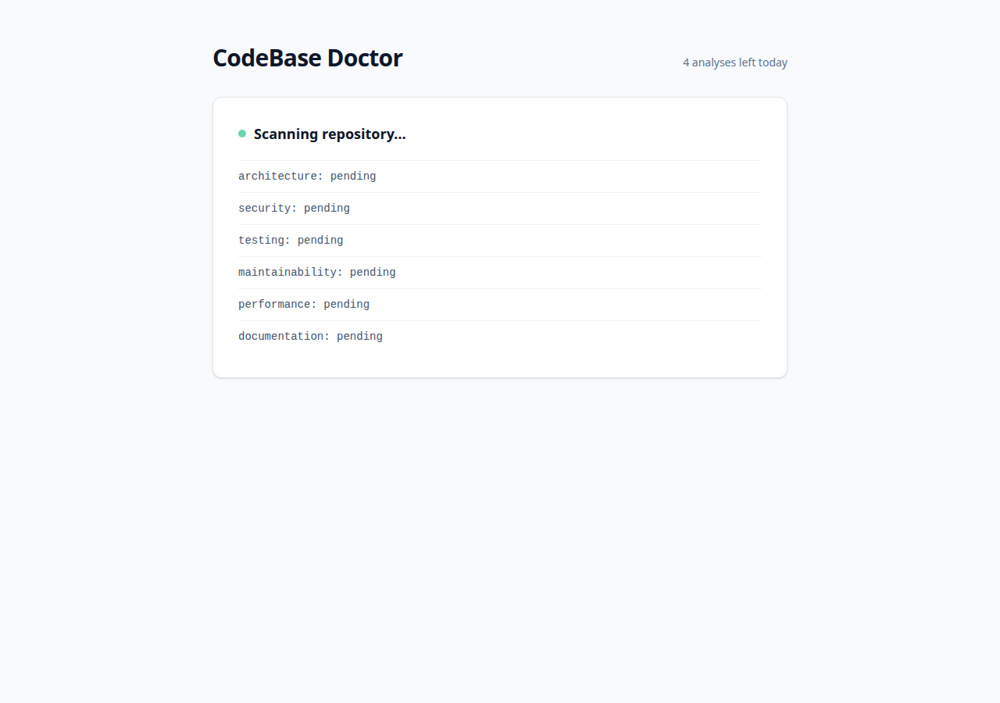
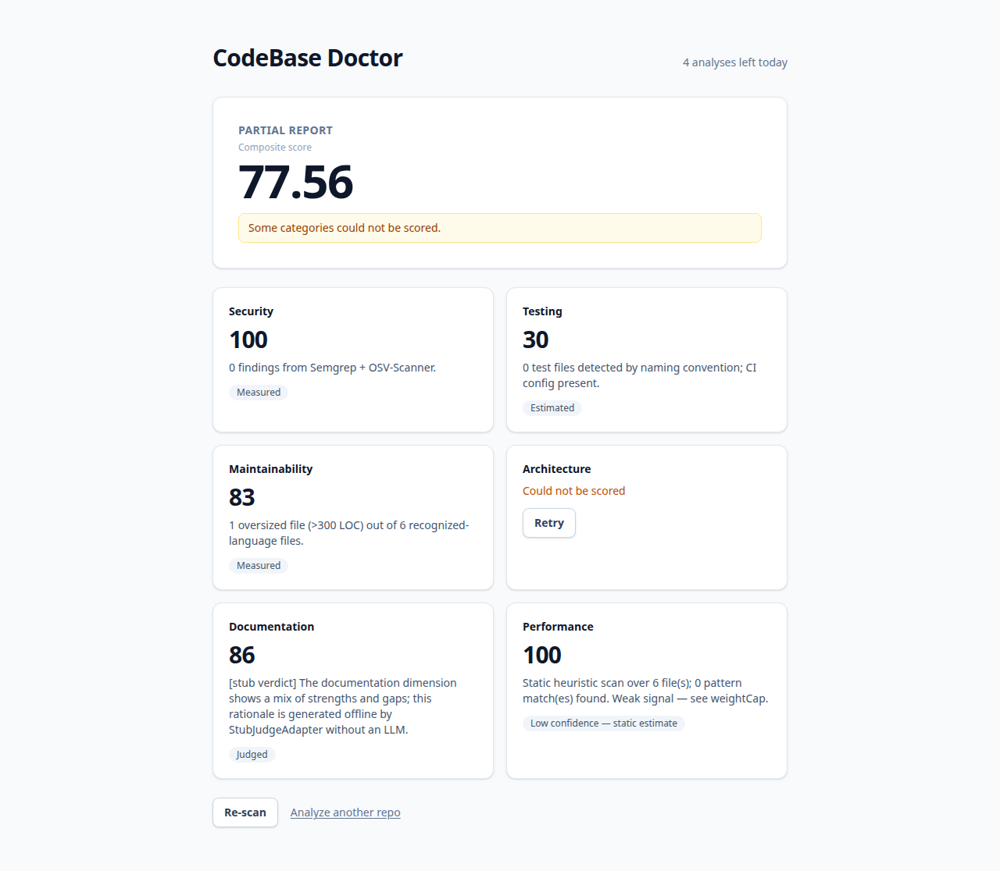

# CodeBase Doctor

**Give it a public GitHub repository URL. Get back a 0–100 score across six engineering dimensions — each with a written rationale and a confidence label.**


---

## What it does

CodeBase Doctor shallow-clones a public GitHub repo into a disposable, network-isolated sandbox and runs six independent analyzers over it:

| Dimension | How it is scored | Confidence label | Weight |
| --- | --- | --- | --- |
| **Architecture** | LLM judge (`LLMJudgePort`) over repo structure and layering | `judged` | 1.0 |
| **Security** | Real **Semgrep** + **OSV-Scanner**, run offline inside the `cbd-scanner` container | `measured` | 1.0 |
| **Testing** | Deterministic heuristics — test-file ratio, naming conventions, CI config | `estimated` | 1.0 |
| **Maintainability** | Deterministic heuristic — share of oversized source files | `measured` | 1.0 |
| **Performance** | Static heuristic pattern scan | `estimated` | **0.5** |
| **Documentation** | README-presence pre-check feeding an LLM judge | `judged` | 1.0 |

The **composite score** is the weighted mean over the categories that actually produced a score, each weighted by its cap. Performance is deliberately capped at `0.5` — the UI renders it as *"Low confidence — static estimate"* so a weak signal never dominates the headline number.

A scan needs **at least 4 of 6** categories to score. At or above that bar the result is persisted as `complete` (6/6) or `partial` (4–5/6) and the user's daily quota unit is kept. Below it, the job is marked `failed` and **the quota unit is refunded**.

The sandbox **never executes repository-provided code** — no `install`, `build`, or `test` step ever runs. Ingestion is hard-capped (~500 MB / 50k files, a 120 s clone timeout, a 300 s scan timeout) and is auditable per scan.

### Example

```bash
curl -s -XPOST localhost:3000/analyses \
  -H 'content-type: application/json' \
  -d '{"repoUrl":"https://github.com/tj/commander.js","forceRescan":false}'
# -> 202 { "jobId": "…", "status": "queued", "commitSha": "…", "pollAfterMs": 2000, "quota": { … } }

curl -s localhost:3000/analyses/<jobId>
# -> 202 while analyzing (per-category progress) … then 200 with the full six-score report
```

---

## Screenshots

The SPA has four states: URL entry → live per-category progress → report → re-scan.

| | |
| --- | --- |
|  | **URL entry** — paste a public GitHub URL. |
|  | **Live per-category progress** — the client polls `GET /analyses/:id`; each of the six categories moves `pending → running → scored`. |
|  | **Completed report** — six cards, composite score, `measured` / `estimated` / `judged` confidence pills, remaining daily quota, and "Re-scan" / "Analyze another repo". |
|  | **Partial report** — a category could not be scored (≥ 4 of 6 still succeeded). The card shows "Could not be scored" with a Retry affordance; the composite is computed from the categories that did score. |
|  | **Failed scan** — fewer than 4 categories scored, or a clone/scan timeout. The job is `failed` and the daily quota unit is refunded. |

---

## Architecture

pnpm-workspaces monorepo, hexagonal (ports-and-adapters). Two NestJS processes share one domain library; a React SPA talks to the HTTP process only.


`RepoAnalysisService` is the hexagonal core: it never touches git, Docker, an LLM SDK, or SQL directly — its only outbound edges are the ports above.

### Request lifecycle

1. **`POST /analyses`** → `resolve(repoUrl)` — cheap, pure URL parsing. A malformed URL throws `InvalidRepoUrlError` → `400`.
2. **Rate-limit check** — `HeadCallRateLimiterPort.checkAndRecord(actorId)`, a fixed-window gate on how often an actor may trigger the expensive repo-lookup step. Over the limit → `429 /errors/rate-limited` (a distinct error type from quota).
3. **`head(ref)`** — spins the `cbd-fetcher` container, runs `git ls-remote`, resolves the current commit SHA. A private or missing repo throws `RepoNotAccessibleError` (the two cases are deliberately indistinguishable) → `422`.
4. **Cache check** — `findCached({ repoUrl, commitSha, engineVersion })`. A hit returns the cached report immediately (`200`, `cached: true`) — **no quota is consumed and no work is done**. Skipped entirely when `forceRescan: true`.
5. **Consume quota** — on a cache miss, `UsageQuotaPort.consume(actorId, reservationId)` reserves one daily unit *before* any job row exists. Over the daily limit → `429 /errors/quota-exceeded` (with `Retry-After`).
6. **Enqueue** — create the `analysis_job` row, push a BullMQ job onto Redis, attach the Bull job id, return `202 { jobId }`.
7. **Worker** — `AnalysisProcessor` materializes the workspace (shallow clone into an ephemeral, network-isolated volume via `cbd-fetcher`, then scans inside `cbd-scanner`), runs the **6 analyzers in parallel**, and aggregates.
8. **Persist or refund** — if ≥ 4 of 6 categories scored, persist the `RepoScan` (`complete` = 6/6, `partial` = 4–5/6) and keep the quota unit. If < 4, mark the job `failed` and refund the quota unit.
9. **Client polls `GET /analyses/:id`** — every non-terminal job status collapses to `analyzing` with a `progress` block; then the terminal `completed` / `completed_partial` / `failed` response.
10. **`StaleJobWatchdogService`** (in the worker, on a schedule) fails jobs that have hung past their deadline and refunds their quota.
11. **`forceRescan: true`** (the "Re-scan" button) bypasses the cache lookups; the worker persists via `saveForced()`, which refreshes the existing cached row in place.

The cache key is `(repoUrl, commitSha, engineVersion)`, where `engineVersion` is a hash of every analyzer's version plus its rubric version — bumping an analyzer automatically invalidates stale cached scans. A partial-unique index (`WHERE status = 'complete'`) keeps exactly one complete scan per key while still allowing a `partial` scan of the same commit to be superseded later.

---

## Repository layout

```
apps/
  api/      NestJS HTTP process — POST /analyses, GET /analyses/:id, RFC 9457 error filter, E2E suite
  worker/   Headless BullMQ consumer — runs the analysis pipeline; StaleJobWatchdogService + scheduler
  web/      React 19 + Vite 8 + Tailwind 4 SPA — url-entry / progress / report / rescan features
libs/
  analysis/     The domain. RepoAnalysisService orchestrator, domain types, engine-version hash,
                and the 6 ports: CategoryAnalyzer, RepoSourcePort, LLMJudgePort, ScoreRepositoryPort,
                UsageQuotaPort, HeadCallRateLimiterPort
  analyzers/    The 6 CategoryAnalyzer adapters + AnalyzersModule (Semgrep/OSV, heuristics, LLM-judged)
  repo-source/  ShallowCloneAdapter — shallow-clones via dockerode into an ephemeral network-isolated
                workspace (cbd-fetcher then cbd-scanner images); URL parsing, git commands, disk-usage caps
  llm/          AnthropicJudgeAdapter (real, paid) / StubJudgeAdapter (free, offline); LlmModule.selectJudge()
  persistence/  Prisma 6 + Postgres schema; RepoScan cache, AnalysisJob lifecycle, per-category progress,
                Redis-backed DailyFreeTierAdapter (quota) and RedisHeadCallRateLimiterAdapter
  jobs/         BullMQ producer (AnalysisQueueProducer) + consumer (AnalysisProcessor)
```

---

## Getting started (local dev)

The default path uses a **free, offline stub LLM** (`LLM_JUDGE=stub`): no Anthropic API key, no network calls, no cost. `DEV-HARNESS.md` has the full walk-through, the rationale, and the gotchas — the summary below is section 4 of that file.

### Prerequisites

- **Node ≥ 20.6** (tested on v24) — needed for `--env-file-if-exists`.
- **pnpm 10** (tested on 10.33).
- **Docker** + `docker compose`, with a working Docker socket.
- The two sandbox images built and present locally:
  ```bash
  docker build -f apps/worker/docker/cbd-fetcher.Dockerfile -t cbd-fetcher:local .
  docker build -f apps/worker/docker/cbd-scanner.Dockerfile -t cbd-scanner:local .
  ```

### Steps

```bash
# 1. Install
pnpm install

# 2. Environment — copy the template and fill the <…> placeholders.
#    The defaults are wired for the docker-compose infra below; LLM_JUDGE=stub needs nothing else.
cp .env.example .env

# 3. Infra — Postgres + Redis
docker compose up -d
#    docker-compose.override.yml republishes Postgres on host 5433 if 5432 is already taken;
#    keep DATABASE_URL in sync with whichever port you land on.

# 4. Database
pnpm --filter @cbd/persistence prisma:generate
pnpm --filter @cbd/persistence prisma:migrate

# 5. The three processes — one shell each; env comes from .env
pnpm --filter @cbd/api    start:dev     # NestJS HTTP on :3000
pnpm --filter @cbd/worker start:dev     # headless BullMQ consumer
pnpm --filter @cbd/web    dev           # Vite dev server (:5173, or the next free port)

# 6. Smoke test
curl -s -XPOST localhost:3000/analyses -H 'content-type: application/json' \
  -d '{"repoUrl":"https://github.com/tj/commander.js","forceRescan":false}'
```

See [`DEV-HARNESS.md`](DEV-HARNESS.md) for the details that bite: why `start:dev` must point tsx at the **root** `tsconfig.json`, how to kill orphaned process trees, `forceRescan` not propagating to the worker in dev, and the port-conflict fixes.

To use the **real** LLM judge, unset `LLM_JUDGE` (or set `LLM_JUDGE=anthropic`) and provide `ANTHROPIC_API_KEY`. In `NODE_ENV=production` the app **fails fast on boot** if no real LLM is configured — it will not silently serve fabricated scores.

---

## Testing

```bash
pnpm test          # Vitest (vitest run) — ~53 spec files across unit, integration, and E2E
pnpm test:watch    # Vitest in watch mode
pnpm typecheck     # tsc --noEmit for the root tsconfig and apps/web
```

- **Strict TDD** throughout — every service was test-driven before it was wired into a live process.
- **Testcontainers** spins real Postgres and Redis for the integration and E2E suites; those specs need a working Docker socket.
- The Security analyzer's integration and E2E tests run **real Semgrep and OSV-Scanner** inside the `cbd-scanner` container.
- E2E scenarios cover the happy path, cache hit, oversized-repo rejection, quota exhaustion, partial completion, below-threshold refund, and security findings.

---

## Configuration

All host-side configuration is environment variables; see `.env.example`.

| Variable | Purpose | Default |
| --- | --- | --- |
| `DATABASE_URL` | Postgres connection string (Prisma) | — (`postgresql://<user>:<password>@localhost:<port>/codebase_doctor`) |
| `REDIS_HOST` | Redis host — BullMQ queue, quota counters, rate-limiter counters | `localhost` |
| `REDIS_PORT` | Redis port | `6379` |
| `PORT` | HTTP port for `apps/api` | `3000` |
| `UPGRADE_URL` | Link surfaced in the `quota-exceeded` problem body | `https://codebasedoctor.dev/pricing` |
| `LLM_JUDGE` | `stub` (free, offline, deterministic) or `anthropic` (real, paid) | `stub` |
| `ANTHROPIC_API_KEY` | Anthropic key — required when `LLM_JUDGE=anthropic` or when `LLM_JUDGE` is unset | — |
| `STUB_JUDGE_FAIL_CATEGORIES` | Dev-only knob: comma-separated `CategoryId`s the stub judge should force-fail (drives the `partial` report state) | — (none) |
| `NODE_ENV` | `production` makes the LLM-judge selection fail fast when no real LLM is configured | `development` |

The `CBD_SEMGREP_*` / `CBD_OSV_*` / `XDG_CACHE_HOME` variables are read only *inside* the `cbd-scanner` container (baked defaults) — never on the host.

---

## API

Base URL in local dev: `http://localhost:3000`.

### `POST /analyses`

```jsonc
// request
{ "repoUrl": "https://github.com/owner/repo", "forceRescan": false }
```

| Response | Body |
| --- | --- |
| `202` — cache miss, job queued | `{ "jobId", "status": "queued", "commitSha", "pollAfterMs": 2000, "quota" }` |
| `200` — cache hit | `{ "jobId": null, "status": "completed", "cached": true, "scanId", "quota", "result": RepoScoreReport }` |

### `GET /analyses/:id`

| Response | Body |
| --- | --- |
| `404` | unknown id |
| `202` — still running | `{ "jobId", "status": "analyzing", "cached": false, "pollAfterMs": 2500, "progress": { "completed", "total", "categories": [{ "category", "status", "score" }] } }` |
| `200` — terminal | `{ "jobId", "status": "completed" \| "completed_partial", "cached": false, "result": RepoScoreReport }` |
| `200` — failed (generic) | `{ "jobId", "status": "failed", "cached": false }` |
| `504 application/problem+json` — failed on a clone/scan timeout | RFC 9457 problem body |

`RepoScoreReport` always carries **exactly six** category entries (a category is never silently dropped), a `compositeScore` (null if nothing scored), `completeness` (`scoredCount / 6`), `status` (`complete` \| `partial`), and the detected language mix.

### Errors — RFC 9457 (`application/problem+json`)

| Status | `type` | When |
| --- | --- | --- |
| `400` | `/errors/invalid-repo-url` | URL is malformed or unsupported |
| `422` | `/errors/repo-not-accessible` | Private or not-found — deliberately indistinguishable (`reason: "private" \| "not-found"`) |
| `422` | `/errors/repo-too-large` | Over the byte-size or file-count ceiling (both gates collapse to this one type) |
| `429` | `/errors/quota-exceeded` | Daily free-tier analyses exhausted — includes `Retry-After` and `upgradeUrl` |
| `429` | `/errors/rate-limited` | Repo-lookup calls too frequent — a **distinct** type from quota; includes `Retry-After` |
| `504` | `/errors/scan-timeout` | Clone or scan step exceeded its timeout (both collapse to this one type) |
| `500` | `about:blank` | Unexpected — no internal detail leaks into the body |

---

## Status / roadmap

**MVP complete** — Phases 1–8: domain and ports, the six analyzer adapters, Docker-sandboxed ingestion, Prisma/Redis persistence, the HTTP API with RFC 9457 errors, the worker pipeline with the stale-job watchdog, the React SPA, and the E2E suite over real Postgres/Redis/Semgrep/OSV.

**Roadmap** (short and honest):

- **i18n language switcher (ES / EN)** — planned next; strings are currently English-only.
- Client-side URL validation before submit (today the first feedback on a bad URL is the `400` round-trip).
- Tuned rate-limit / quota constants — the limit and window values are a fixed policy baked into the adapters.
- A dedicated scan-timeout E2E scenario (the `504` path is unit-covered but not yet end-to-end).
- Decide whether `forceRescan` should propagate through to the worker's own cache check (see `DEV-HARNESS.md` §5, gotcha 1).

---

## License

License: TBD — no `LICENSE` file is present in the repository yet.
